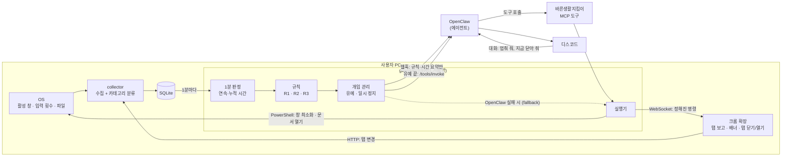

# 🧠 Pattern Bridge — 바른생활지킴이

> **생활 데이터를 걸러 AI 에이전트가 나설 때를 정하는 데이터 거름망, 그리고 여기에 바른생활 특성을 더해 만든 바른생활지킴이**


지금의 AI 에이전트는 사용자가 말해야 움직입니다. 그런데 새벽까지 쇼츠를 보거나 할 일을 미루는 문제는, 사용자가 스스로 알아차리지 못하거나 알아도 도와 달라고 하지 않는 순간에 생깁니다.

**Pattern Bridge**는 사용자와 AI 에이전트(OpenClaw) 사이에 놓이는 **데이터 거름망**입니다. PC에서 쏟아지는 활동 데이터를 그대로 에이전트에 넘기지 않고, 규칙으로 걸러 "지금 나서야 할 때"인지와 "무엇까지 해도 되는지"만 넘깁니다. 원시 데이터(URL, 창 제목)는 로컬에 남고, 에이전트에는 요약만 갑니다.

**바른생활지킴이**는 이 거름망에 **바른생활 특성**을 더해 만든 첫 적용 사례입니다.

```
Pattern Bridge (데이터 거름망)
  + 바른생활 특성: 오락·생산·여가 분류, 연속·누적 시간, 새벽 시간대, 평소 공부량 기준선
  = 바른생활지킴이
```

그래서 바른생활지킴이는 부르지 않아도 먼저 움직입니다. 오락이 길어지거나 평소보다 할 일이 밀리면 디스코드로 먼저 말을 걸고, 화면에서는 오락 탭을 정리하거나 공부할 창을 열어 줍니다. 특성을 바꾸면 같은 거름망 위에 다른 지킴이도 만들 수 있습니다.

| | 바른생활지킴이가 하는 일 |
| --- | --- |
| 👀 **살피기** (behavior tracking) | 활성 창, 브라우저 탭, 입력 횟수를 1분 단위로 모아 오락·생산·여가·중립으로 분류 |
| 🧭 **맥락 읽기** (context-aware) | 연속 시간, 오늘 누적, 시간대(새벽), 평소 이 시각까지의 공부량과 비교 |
| 🙋 **먼저 움직이기** (proactive) | 사용자가 부르지 않아도 개입할 때를 스스로 판단하고 OpenClaw를 깨움 |
| ✋ **개입하기** (behavior intervention) | 디스코드 메시지 → 카운트다운 배너 → 오락 탭 정리, 공부 창 열기 |
| 🔒 **안전하게** (agent safety) | 규칙으로 판단, 좁은 도구만, 실패하면 직접 실행, 언제든 일시 정지 |

---

## 💡 핵심 아이디어

**판단은 규칙으로, 대화는 에이전트가, 에이전트가 실패하면 지킴이가 직접.**

| 역할 | 누가 | 왜 |
| --- | --- | --- |
| **판단** (개입할 상황인가) | guardian (규칙) | 사용자의 창을 닫는 개입이라, 같은 상황이면 항상 같은 결정이 나오고 이유를 설명할 수 있어야 함 |
| **수행** (대화, 도구 호출) | 에이전트 (OpenClaw) | 사람에게 말을 걸고 도구를 고르는 건 에이전트가 잘하는 일 |
| **안전장치** (fallback) | guardian 실행기 | 에이전트가 느리거나 실패해도 개입이 빠지면 안 됨 |

```
쇼츠를 40분째 연속으로 봄
↓
guardian: R1 발동 (오락 연속 40분)
↓
화면: 오락 탭에 5분 카운트다운 배너  +  디스코드: "40분째 보고 있어요, 잠깐 쉬어 갈까요?"
↓
5분 뒤 오락 탭만 정리 (문서·공부 탭은 그대로)
```

---

## 🧯 에이전트 안전 설계

사용자의 화면을 직접 건드리는 에이전트라서, "먼저 움직이는 것"만큼 "선을 넘지 않는 것"이 중요합니다.

- **판단은 LLM이 아니라 규칙이 합니다.** 개입 여부는 `config/intervention.json`의 기준으로만 정해지고, 같은 상황이면 항상 같은 결과가 나옵니다.
- **좁은 도구만 줍니다.** 탭 닫기와 배너는 우리 크롬 확장이 정해진 명령만 실행합니다. 에이전트에게도 셸·파일·브라우저 같은 넓은 기본 도구는 끄고, 규칙이 이미 시작한 개입만 실행하거나 정지·재개·상태 조회만 하는 바른생활지킴이 MCP 도구 6개만 줍니다.
- **민감한 내용은 LLM으로 보내지 않습니다.** 웹훅에는 규칙, 시간, 시간대, 예정 동작만 들어가고 URL·제목·사이트 이름은 빠집니다.
- **되돌릴 틈을 줍니다.** 모든 강제 동작 전에 5분 카운트다운이 있고, 오락에서 벗어나면 멈추며, '지금 닫기'로 바로 끝낼 수도 있습니다.
- **사용자가 끌 수 있습니다.** 확장 팝업에서 30분, 1시간, 오늘, 직접 켤 때까지 개입을 멈출 수 있습니다.
- **에이전트가 실패해도 빠지지 않습니다.** 유예가 끝나면 OpenClaw Gateway를 거쳐 지킴이 도구로 실행하고(LLM 없음), OpenClaw가 꺼져 있거나 5초 안에 응답이 없으면 guardian 실행기가 직접 수행합니다.
- **연결은 잠가 둡니다.** 크롬 확장 ID를 고정하고, 수집 엔드포인트는 확장 Origin과 토큰을 검사합니다.

판단과 도구가 모두 거름망 쪽에 있어서, 에이전트를 다른 것으로 바꿔도 판단 로직은 그대로입니다.

---

## 🚦 개입 규칙

| 규칙 | 조건 | 개입 |
| --- | --- | --- |
| **R1 오락 연속** | 오락을 40분 연속 (0~5시는 20분) | 5분 카운트다운 → 모든 브라우저의 오락 탭 정리. 끝난 뒤 10분은 쉬고, 그 사이 돌아오면 1분 다시 경고 한 번만 |
| **R2 생산 부족** | 매분 확인. 오늘 공부·작업이 평소 이 시각까지의 50% 미만이고 지금 공부 중이 아님 | 5분 카운트다운 → 오락 탭 정리, 창 최소화, 평소 쓰던 문서·사이트 열기. 끝난 뒤 60분은 쉼 |
| **R3 소비 과다** | 오늘 오락 + 여가(운동 제외) 2시간 초과 | 디스코드로 제안만. 이후 30분마다, 그 순간 오락·여가 중일 때만 |

- 우선순위는 R2 > R1 > R3입니다.
- 카운트다운 중에 오락에서 벗어나면 일시 정지되고, 마감 전에 돌아오면 남은 시간부터 이어집니다. R2는 공부를 시작하면 취소됩니다.
- 브라우저 확장 팝업에서 개입을 일시 정지할 수 있습니다 (30분, 1시간, 오늘, 직접 켤 때까지).
- 활동 분류(오락, 생산, 여가, 중립)는 `config/categories.json`과 `config/intervention.json`에서 정합니다. 기준 시간과 데모 값도 `config/intervention.json`에 있습니다.

---

## 🏗️ 시스템 구조



- **collector**와 **guardian**은 별도 프로세스입니다. 네이티브 모듈(창 감지, 입력 훅)이 있는 수집 쪽이 죽어도 판단·실행 상태가 지켜지도록 나눴고, 둘은 SQLite로만 연결됩니다.
- 크롬 확장은 탭 상태를 collector에 보고하고, guardian의 정해진 명령(탭 목록, 탭 닫기·열기, 배너, 알림)만 실행합니다.
- guardian은 바른생활지킴이 MCP 서버(`127.0.0.1:7703`)를 열고, OpenClaw는 이 서버의 도구로 개입을 실행하거나 디스코드 대화를 처리합니다. 설정은 [docs/openclaw-setup.md](docs/openclaw-setup.md)에 있습니다.

```
pattern-bridge/
├── src/
│   ├── collector/        # 수집: 활성 창, 탭 보고(/collect), 입력 횟수, 파일, heartbeat, 분류기
│   ├── guardian/         # 데이터 거름망: 1분 판정, 기준선, 규칙, 개입 관리, 실행기, 메시지, 일시 정지
│   ├── trigger/          # OpenClaw 웹훅 클라이언트
│   ├── db/               # SQLite 스키마
│   ├── analyzer/         # (이전 방향) 패턴 엔진, 놓침 감지
│   └── ui/               # Electron 대시보드
├── browser-extension/    # 크롬 계열 확장 (Manifest V3)
├── config/               # categories.json (분류), intervention.json (개입 정책)
├── openclaw/workspace/   # OpenClaw 에이전트 지침 파일 (npm run openclaw:workspace로 복사)
├── scripts/              # 데모 DB, R2 수동 실행, 창 제목 정리, 데이터셋 변환
├── docs/                 # 테스트 시나리오, 프라이버시 설계, OpenClaw 연동 설정
└── ecosystem.config.cjs  # PM2 (collector, guardian)
```

---

## 🚀 시작하기

### 사전 요구사항
- Windows, Node.js v20 이상
- 크롬 계열 브라우저 (Chrome, Edge, Whale, Brave 등)
- 디스코드 메시지를 받으려면: OpenClaw와 디스코드 봇 연결

### 설치와 환경 설정

```cmd
git clone https://github.com/hjdd0309/pattern-bridge.git
cd /d pattern-bridge
npm install
copy .env.example .env
```

`.env`에서 아래 값을 채웁니다.

| 값 | 내용 |
| --- | --- |
| `OPENCLAW_WEBHOOK_URL`, `OPENCLAW_TOKEN` | OpenClaw 웹훅 주소와 토큰 |
| `NOTIFY_CHANNEL`, `NOTIFY_TO` | `discord`와 메시지를 받을 디스코드 채널 ID (비어 있으면 메시지를 보내지 않음) |
| `EXTENSION_TOKEN` | 크롬 확장과 연결할 아무 긴 무작위 문자열 |
| `GUARDIAN_MCP_TOKEN` | 바른생활지킴이 MCP 서버 토큰 (OpenClaw 설정에도 같은 값) |
| `OPENCLAW_GATEWAY_TOKEN` | OpenClaw Gateway 토큰. 규칙 실행을 OpenClaw 경유로 보낼 때 씀 |

OpenClaw 쪽 설정(MCP 서버 등록, 도구 권한, 디스코드 허용 목록, 에이전트 지침)은 [docs/openclaw-setup.md](docs/openclaw-setup.md)를 따릅니다.

### 실행

```cmd
:: 데모 DB 만들기 (처음 한 번만, 익명화 데이터를 최근 날짜로 옮긴 사본)
npm run demo-db

:: 터미널 1: collector
npm run dev
```

```cmd
:: 터미널 2: guardian (데모 모드: 기준 시간을 짧게)
set GUARDIAN_DEMO=1
npm run guardian:dev
```

그다음 `browser-extension` 폴더를 브라우저에 "압축해제된 확장 프로그램"으로 불러오고, 팝업에 `EXTENSION_TOKEN` 값을 입력합니다. 확장 설치, 연결 확인, 시나리오별 테스트 절차는 [docs/test-scenarios.md](docs/test-scenarios.md)에 있습니다.

백그라운드로 계속 돌리려면 PM2를 씁니다.

```cmd
npm run start:all
```

---

## 📊 수집 데이터

| 데이터 | 방법 | 저장 |
| --- | --- | --- |
| 활성 창 | OS API, 1초마다 | 앱 이름, 카테고리. 창 제목은 브라우저만 (로컬 문서는 `local.pdf`처럼 확장자만) |
| 브라우저 탭 | 크롬 확장이 탭이 바뀔 때 보고 | URL, 제목, 카테고리. 로컬 파일은 `file:///local.pdf`처럼 확장자만 |
| 입력 활동 | 글로벌 훅, 1분마다 | 키보드·마우스 **횟수만** (입력 내용, 좌표 없음) |
| 파일 열기·저장 | 바탕화면·문서·다운로드 폴더 감시 | 경로, 확장자 (내용은 읽지 않음) |
| collector 상태 | 30초마다 heartbeat | 꺼져 있으면 판단을 멈춤 |

## 🔒 프라이버시

- 모든 데이터는 **로컬 SQLite에만** 저장됩니다.
- 외부로 나가는 건 OpenClaw로 보내는 웹훅뿐이고, 여기에는 **규칙, 시간, 시간대, 예정 동작**만 들어갑니다. 사이트 이름, URL, 제목은 넣지 않습니다.
- 에이전트가 쓰는 바른생활지킴이 도구는 개입 ID와 정해진 값만 받고, 응답에 URL·창 제목·경로를 넣지 않습니다.
- 브라우저 밖 앱의 창 제목(제목 없는 메모장의 첫 줄, 카카오톡 대화 상대 이름 등)은 저장하지 않습니다. 이 규칙 전에 쌓인 기록은 `npm run redact-titles`로 정리할 수 있습니다.
- 30일이 지난 원시 텍스트(제목, 전체 URL, 경로)는 도메인과 카테고리만 남깁니다.

자세한 내용은 [docs/privacy-design.md](docs/privacy-design.md)에 있습니다.

---

## 🗺️ 진행 상황

| 단계 | 내용 | 상태 |
| --- | --- | --- |
| 0~2 | collector 정리, 1분 판정과 활동 추적, R2 기준선과 하루 요약 | ✅ |
| 3 | 규칙 엔진 (R1·R2·R3), 개입 상태 관리, OpenClaw 메시지 | ✅ |
| 4 | 크롬 확장 연동, 배너·탭 정리·생산 모드 실행기, 일시 정지 (실제 브라우저 시나리오 A~J 통과) | ✅ |
| 5 | 바른생활지킴이 MCP 서버, 규칙 실행의 OpenClaw Gateway 경유와 fallback, 디스코드 대화로 정지·재개·상태·지금 닫기 | 구현 완료, 실사용 시나리오 K~P 예정 |
| 6 | CLI 정지·상태, 데모 값 조정, 평가 리포트 (행동 전환율, agent/fallback 비율) | 예정 |

---

## 📐 연구 범위

이 프로젝트는 **한 사람의 실제 PC 사용 데이터를 바탕으로 한 사례 연구**입니다.

- **기준선과 데모:** R2의 "평소 공부량"은 본인 데이터(익명화 사본)로 계산하고, 데모에서는 이 데이터를 최근 날짜로 옮겨 씁니다.
- **검증:** 개입 동작은 실제 브라우저 시나리오로 확인했고([docs/test-scenarios.md](docs/test-scenarios.md)), 활동 분류 정확도와 규칙 발동 빈도는 아래 공개 PC 데이터셋으로 확인합니다.
- **범위 밖:** 여러 사용자에 대한 개입 효과, 장기간 사용에 따른 습관 변화는 다루지 않으며 향후 과제로 남깁니다.

---

## 📦 데이터셋

### 익명화 데이터

실제 수집한 데이터(이벤트 164,551건, 탐지 패턴 607건, 알림 10건)를 익명화해 `dataset/pattern-bridge-anon.sqlite`로 포함했습니다.

- **유지:** 이벤트 종류, 발생 시각, 앱 이름, 탐지 패턴, 알림 로그
- **제거:** 창 제목, 파일 경로(확장자만 남김), 브라우저 URL(도메인만 남김)
- **추가:** 활동 카테고리 `category`(`entertainment`, `sns`, `study`, `work`, `leisure`, `exercise`, `communication`, `shopping`, `finance`, `search`, `system`, `other`)와, 해당하면 세부 분류 `subcategory`(`shortform`, `video`, `game`, `webtoon` 등)

카테고리 규칙은 `config/categories.json`에 있고, 위에서부터 순서대로 검사해 처음 맞는 규칙을 적용합니다. 익명화 사본은 `python scripts/anonymize-data.py`로 다시 만들 수 있습니다. 시연용 소량 DB는 `dataset/pattern-bridge-demo-anon.sqlite`(이벤트 692건)입니다.

이 DB로 대시보드를 바로 열려면:

```cmd
set DB_PATH=dataset/pattern-bridge-anon.sqlite
npm run ui
```

### 공개 PC 데이터셋

변환 스크립트는 `scripts/import-public-pc.py`입니다. 타임스탬프는 주 단위로 옮겨 시간대와 요일을 그대로 유지했습니다.

| 데이터셋 | 폴더 | 내용 | 라이선스 |
| --- | --- | --- | --- |
| [Labelled AWT](https://github.com/project-pivot/labelled-awt-data) (Beerepoot, 2024) | `dataset/public/awt/` | 1명의 4주 치 활성 창 로그 10,066건. 창마다 수동으로 단 활동 라벨이 있음 | GPL-3.0 |
| [SWELL-KW](https://doi.org/10.17026/dans-x55-69zp) (Koldijk 외, 2014) | `dataset/public/swell/` | 25명이 휴식, 보통, 방해, 시간 압박 조건에서 일할 때의 분 단위 키보드·마우스·앱 전환 특징 3,139분 | CC BY-NC-SA 4.0 |
| [GESIS Web Tracking](https://zenodo.org/records/4757574) (Kulshrestha 외, 2021) | `dataset/public/gesis/` | 독일 사용자 2,148명의 한 달 치 웹 방문 9,151,243건. 도메인마다 41종 카테고리가 붙어 있음 | CC BY-NC 4.0 |
| BEHACOM (PC 사용 행동, 12명) | `dataset/public/behacom/` | 변환 DB 이벤트 40,581건 | 원본 데이터셋 조건 |

- GESIS는 원본 `browsing.csv`(680MB)에서 쓰는 컬럼만 남겨 `browsing-compact.csv.gz`(49MB)로 넣었습니다. 9,151,243건 전체가 들어 있습니다.
- `pattern-bridge-gesis-sample50.sqlite`는 사용자 50명을 시드 고정으로 뽑은 표본입니다(208,054건). 인원을 바꾸려면 아래처럼 다시 만듭니다.

```cmd
set GESIS_USERS=50
python scripts/import-public-pc.py gesis dataset/public/gesis dataset/public/gesis/pattern-bridge-gesis-sample50.sqlite
```

> OpenClaw는 PC에서 동작하므로 폰 데이터셋(LSApp, LiveLab)은 포함하지 않습니다.

---

## 🔄 이전 방향: 루틴 놓침 알림

처음에는 **평소 루틴을 놓쳤을 때 먼저 알려 주는** 분석 레이어였습니다. 3가지 알고리즘 앙상블(베이지안 시간대 분석 40%, PrefixSpan 시퀀스 마이닝 35%, FFT 주기 분석 25%)로 "매일 9시에 Chrome을 연다" 같은 패턴을 찾고, 예상 시간이 지나도 그 앱을 쓰지 않으면 알림을 보냈습니다.

방향을 바꾼 이유는 두 가지입니다.

- 몇 달 사이 AI 에이전트가 크게 발전하면서, 패턴을 분석해 알려 주는 것만으로는 충분하지 않게 됐습니다.
- 알림에서 그치지 않고, 탭을 정리하고 공부할 창을 여는 것처럼 **직접 행동하는** 에이전트를 만들고자 했습니다.

패턴 엔진 코드(`src/analyzer`, `src/scheduler`)는 비교 근거로 남겨 두었고, 기능은 꺼져 있습니다. `npm run check`, `npm run eval-report`, `npm run ablation`으로 결과를 볼 수 있습니다.

---

## ⚙️ 기술 스택

**언어·런타임**<br>


**데이터·수집**<br>


**브라우저·실행**<br>


**운영·UI**<br>


**에이전트·알림**<br>


