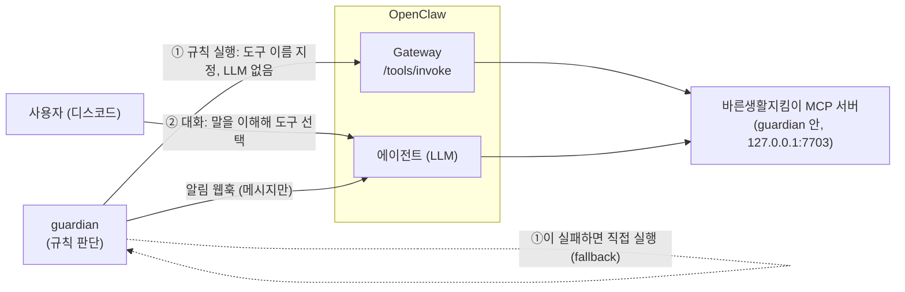

# OpenClaw 연동 설정

바른생활지킴이(guardian)를 OpenClaw에 연결하는 방법이다. 값은 모두 자리표시자이고, 실제 값은 각자의 `.env`와 `~/.openclaw/openclaw.json`에만 둔다.

---

## 1. 구조

guardian 안에 **바른생활지킴이 MCP 서버**가 있고, OpenClaw가 이 서버의 도구 6개를 쓴다. 도구를 부르는 길은 두 가지다.



| 길 | 언제 | LLM | 기록 (`executed_by`) |
| --- | --- | --- | --- |
| ① 규칙 실행 | 유예 마감, 배너 "지금 닫기" | 없음 | `gateway` |
| ② 디스코드 대화 | 사용자가 "지금 닫아 줘", "30분만 멈춰 줘" 등 | 있음 | `agent` |
| fallback | ①이 실패했을 때 (OpenClaw 꺼짐, 오류, 5초 안에 응답 없음) | 없음 | `fallback` |

개입 알림 웹훅은 지금처럼 메시지만 보낸다. 알림을 받은 에이전트는 도구를 쓰지 않는다.

### 도구 6개

| 도구 | 하는 일 | 인자 |
| --- | --- | --- |
| `close_entertainment_tabs` | 진행 중인 R1을 지금 실행 (오락 탭 정리) | `interventionId` (선택) |
| `start_focus_mode` | 진행 중인 R2를 지금 실행 (생산 모드) | `interventionId` (선택) |
| `get_intervention` | 진행 중인 개입과 최근 개입 상태 | 없음 |
| `pause_interventions` | 개입 일시 정지 (진행 중인 개입은 취소) | `preset` (`30m`, `1h`, `today`, `manual`) 또는 `minutes` (1~600) |
| `resume_interventions` | 일시 정지 해제 | 없음 |
| `get_pause_status` | 정지 상태 | 없음 |

- 실행 도구는 규칙이 이미 시작한 개입만 실행한다. 새 개입을 만들 수 없다.
- 응답에는 규칙, 상태, 시각만 있고 URL, 창 제목, 파일 경로는 없다.
- OpenClaw 안에서는 `guardian__close_entertainment_tabs`처럼 `<서버 이름>__<도구>`로 보인다.

---

## 2. 준비

- **OpenClaw 2026.11.10 이상.** `/tools/invoke`로 MCP 도구를 부르는 기능(①)이 이 버전에 처음 들어왔다. 이전 버전에서는 ①이 항상 `404 Tool not available`로 실패하고 fallback으로 실행된다.

  ```cmd
  npm install -g openclaw@latest
  ```

- **Windows 개발자 모드 켜기.** 업데이트 후 첫 실행 때 플러그인 폴더에 심볼릭 링크를 만드는데, 개발자 모드가 꺼져 있으면 `EPERM: operation not permitted, symlink`로 게이트웨이가 바로 꺼진다.

  ```cmd
  start ms-settings:developers
  ```

- **업데이트 후 첫 실행은 오래 걸릴 수 있다.** 상태 이전 작업(`doctor --fix --state-upgrade…`)이 끝날 때까지 게이트웨이가 열리지 않고 다른 `openclaw` 명령도 막힌다 (실측 약 30분). 끊지 말고 기다린다. 진행 기록은 `~/.openclaw/.upgrade-<버전>-…/chain.log`.

---

## 3. Pattern Bridge `.env`

| 값 | 내용 |
| --- | --- |
| `GUARDIAN_MCP_TOKEN` | MCP 서버 토큰. 아무 긴 무작위 문자열. 없으면 MCP 서버를 열지 않는다 |
| `OPENCLAW_GATEWAY_TOKEN` | OpenClaw Gateway 토큰 (`openclaw.json`의 `gateway.auth.token`). ①에 쓴다. **게이트웨이 운영자 권한**이라 `.env`에만 둔다. 없으면 ①을 건너뛰고 바로 fallback |
| `OPENCLAW_GATEWAY_URL` | 선택. 비우면 `OPENCLAW_WEBHOOK_URL`의 호스트를 쓴다 |
| `OPENCLAW_INVOKE_TIMEOUT_MS` | 선택. ①을 기다리는 시간, 기본 5000. 넘으면 fallback |

guardian을 켜면 로그에 `[mcp] agent tools on http://127.0.0.1:7703/mcp`가 보여야 한다.

---

## 4. OpenClaw 설정 (`~/.openclaw/openclaw.json`)

바꾸기 전에 `openclaw.json`과 `workspace/` 폴더를 백업한다. 바꾼 뒤에는 `openclaw config validate`로 검사하고 `openclaw gateway restart`로 재시작한다. **도구 권한(`tools`)은 재시작해야 반영된다.**

```json5
{
  mcp: {
    servers: {
      guardian: {
        url: "http://127.0.0.1:7703/mcp",
        transport: "streamable-http",          // 빼면 SSE로 붙는다
        headers: { Authorization: "Bearer <GUARDIAN_MCP_TOKEN>" },
        connectionTimeoutMs: 5000,
        requestTimeoutMs: 15000,
      },
    },
  },
  tools: {
    profile: "minimal",           // 셸, 파일, 웹, 메시지 도구를 끈다
    alsoAllow: ["bundle-mcp"],    // MCP 서버 도구만 다시 연다
    codeMode: false,              // 11.10은 Gemini 등에서 Code Mode를 자동으로 켠다 (아래 참고)
    toolSearch: false,            // 도구 검색 없이 도구 설명을 바로 준다 (아래 참고)
  },
  channels: {
    discord: {
      groupPolicy: "allowlist",
      guilds: {
        "<디스코드 서버 ID>": { users: ["<본인 디스코드 사용자 ID>"], requireMention: false },
      },
    },
  },
}
```

- **`codeMode: false`:** 켜져 있으면 모델이 도구를 직접 부르지 않고 자바스크립트를 짜서 부른다. 실측에서 알림 하나에 Gemini를 17번 불러 무료 한도(429)에 걸렸고 디스코드 전달이 117초 걸렸다. 기본 실행기는 보안 격리도 아니다. 끄면 43초.
- **`toolSearch: false`:** 켜져 있으면 에이전트가 도구 목록을 먼저 검색해야 해서 LLM 호출이 한 번 는다. 도구가 6개뿐이라 처음부터 보여 주는 편이 낫다.
- **디스코드 ID**는 디스코드 개발자 모드를 켜고 서버 아이콘과 내 프로필을 우클릭해 "ID 복사"로 얻는다.

### 확인

```cmd
openclaw mcp probe guardian
```

`tools: 6`이 나오면 OpenClaw가 MCP 서버에 접속한 것이다. ①은 Gateway 토큰으로 상태 조회 도구를 불러 확인한다 (응답 `200`, `{"ok":true,…}`). 셸 도구 `exec`는 `404`여야 한다.

---

## 5. 에이전트 지침 파일

`openclaw/workspace/`의 `AGENTS.md`, `SOUL.md`, `IDENTITY.md`, `USER.md`가 원본이다. OpenClaw는 `~/.openclaw/workspace/`에서 읽으므로 고친 뒤 복사한다.

```cmd
npm run openclaw:workspace
openclaw gateway restart
```

- 바뀐 파일은 덮어쓰기 전에 `.bak`으로 남는다. `-- --dry-run`으로 미리 볼 수 있다.
- 기본 템플릿(약 1.2만 자) 대신 바른생활지킴이용 짧은 지침을 쓰면 매 호출 입력이 줄고, "상태 어때?"를 OpenClaw 자체 상태(`session_status`)가 아니라 지킴이 도구로 처리한다.
- 디스코드 채널에 예전 대화가 쌓여 있으면 예전 방식을 따라 할 수 있다. 지침을 바꾼 뒤에는 채널에서 `/new`로 세션을 새로 시작한다.

---

## 6. 실측과 알려진 한계 (2026-11-27, OpenClaw 2026.11.10, Gemini 3.5 flash-lite)

| 항목 | 값 |
| --- | --- |
| ① 규칙 실행 (`/tools/invoke` → MCP) | 평소 0.3~2초, 게이트웨이 재시작 직후 첫 호출 9~12초 |
| 알림 웹훅 → 디스코드 전달 | 43초 (업데이트 전 기준값 중앙값 48초) |
| 디스코드 대화 ("지금 상태 어때?") | 약 20초 (OpenClaw 준비 8~13초 + LLM 2번) |
| 게이트웨이 재시작 → 디스코드 연결 | 2~3분 (디스코드 플러그인 로딩) |

- **게이트웨이가 켜지는 2~3분 동안**은 디스코드 메시지가 가지 않고(웹훅이 `400 channel must be last`로 거부됨), 개입은 fallback으로 실행된다.
- **①이 5초를 넘으면 fallback.** 개입은 제시간에 실행되고 기록만 `fallback`이 된다. 기록의 `gateway`/`fallback` 비율이 OpenClaw 경로의 안정성 지표다.
- **디스코드 답장은 "작업 중" 메시지가 먼저 뜨고 완성되면 그 메시지가 답으로 바뀐다.** OpenClaw 디스코드의 기본 진행 표시(`channels.discord.streaming.mode: "progress"`)다.
- **Message Content Intent가 제한(`content=limited`)이면** 봇을 멘션하지 않은 메시지 내용을 못 받을 수 있다. 그럴 때는 `@봇 메시지`로 보내거나 디스코드 개발자 포털에서 Message Content Intent를 켠다.
- **메모리 플러그인의 꿈 일기(`DREAMS.md`)** 가 하루 몇 번 Gemini를 불러 무료 한도를 조금씩 쓴다.
- **11/29 이후 `connectionTimeoutMs`, `requestTimeoutMs` 이름이 바뀔 예정**이다 (11.10 변경 예고). `openclaw doctor --fix`로 새 이름으로 바꿀 수 있다.

---

## 7. 테스트할 때 주의

`.env`에 실제 Gateway 토큰이 있으면 단위 테스트가 마감 실행 때 **실제 OpenClaw로 요청을 보낸다.** 테스트용 개입 ID가 실제 guardian까지 갈 수 있으니, 테스트는 게이트웨이 주소를 닫힌 포트로 지정해서 돌린다.

```cmd
set OPENCLAW_GATEWAY_URL=http://127.0.0.1:9
```
